To work with AMMP (and Ray) in a shared Microsoft Teams channel, your Microsoft 365 admin needs to allow shared channels with external organisations. It's a one-time change that takes about 5 minutes. Pick one of the two options below.

| | Option 1: Open mode | Option 2: Allow AMMP only |
|---|---|---|
| **What it does** | Allows shared channels with any external organisation that also allows them | Allows shared channels with AMMP Technologies B.V. only |
| **Where** | Teams admin center | Microsoft Entra admin center |
| **Best for** | Most organisations, if your IT policy permits open external collaboration | Organisations that require external access to be approved per partner |

You only need one of the two. If you're unsure, ask your IT or security team which one fits your policy.

## Option 1: Switch Teams external collaboration to Open mode

Open mode allows shared channels with any external organisation that has also enabled them. It's the quickest route and suits most organisations.

**Who can do it:** a Global Administrator. Teams Administrators can view this page but can't apply Open mode, because it changes Microsoft Entra B2B direct connect settings.

**What changes:** Open mode sets the default B2B direct connect settings in Entra to Allowed, inbound and outbound, for all external organisations. Your users can then join shared channels hosted by any organisation that also allows it, and your team owners can invite people from those organisations. Open mode also applies open presets to other external collaboration settings (guest access, external chat and meetings); the confirmation screen lists exactly which of your settings will change before anything is applied.

**Step 1.** Open the [Teams admin center external collaboration settings](https://admin.teams.microsoft.com/external-collaboration/settings) (Teams admin center > External collaboration > Overview). The Overview shows your current mode and whether shared channels are allowed. Select **Explore modes**.

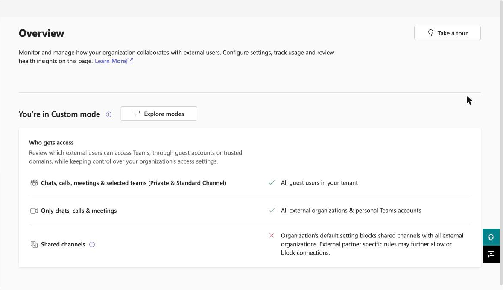

**Step 2.** Select the **Open mode** card, review the preset under "Who gets access", then select **Next**.

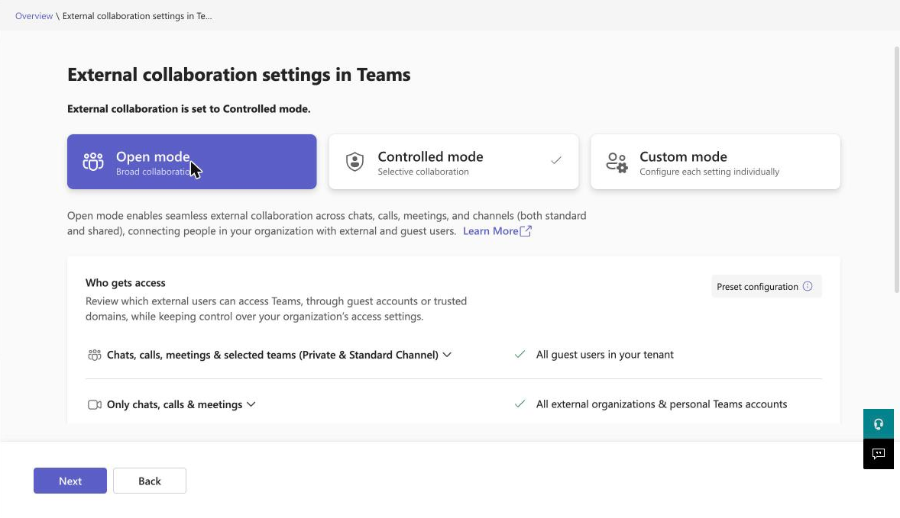

**Step 3.** Review the list of settings that will change. It shows each setting's current and new value. Select **Confirm**. Microsoft notes the changes may take some time to apply.

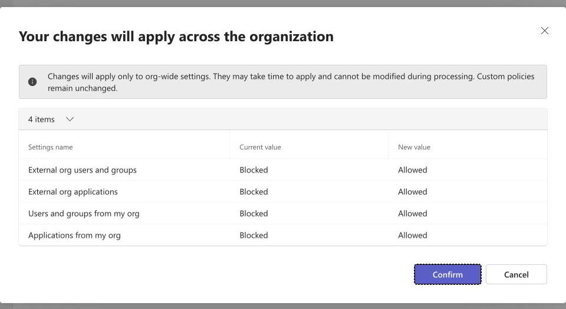

**If Next is greyed out:** hovering over it shows the message below. In our testing this appeared when the tenant already had organisation-specific B2B direct connect settings in Entra cross-tenant access settings. If you see it, use Option 2 instead, or ask your Entra admin to review those organisation entries.

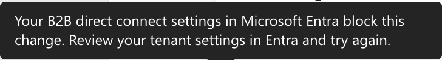

If Open mode isn't acceptable under your policies, use Option 2.

## Option 2: Allow shared channels with AMMP only

This option adds AMMP Technologies B.V. as an organisation in Microsoft Entra cross-tenant access settings and allows B2B direct connect with AMMP alone. Your default settings for every other organisation stay as they are.

**Who can do it:** at least a Security Administrator (or a Global Administrator). Teams Administrators can read these settings but can't change them.

You'll allow four things for AMMP, all on the **B2B direct connect** tab:

| Direction | Sub-tab | Access status | Applies to |
|---|---|---|---|
| Inbound | External users and groups | Allow access | All AMMP Technologies B.V. users and groups |
| Inbound | Applications | Allow access | All applications |
| Outbound | Users and groups | Allow access | All users in your organisation |
| Outbound | External applications | Allow access | All external applications |

A banner about Microsoft Entra ID Premium may appear at the top of these pages. You can ignore it: Premium is only needed to target specific users or apps, not for the "All" options above.

### Add AMMP as an organisation

**Step 1.** Open [Entra admin center > External Identities > Cross-tenant access settings](https://entra.microsoft.com/#view/Microsoft_AAD_IAM/CompanyRelationshipsMenuBlade/~/CrossTenantAccessSettings/menuId/ExternalIdentitiesGettingStarted). On the **Organizational settings** tab, select **Add organization**.

**Step 2.** Type **ammp.io**. Check that the result shows **AMMP Technologies B.V.** with tenant ID `7c92f820-b54f-45fc-9668-84481746e993`, then select **Add**.

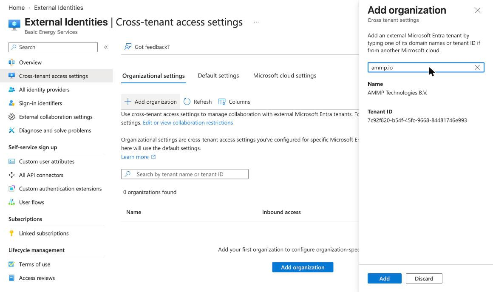

AMMP now appears in the list with **Inherited from default** under both Inbound access and Outbound access.

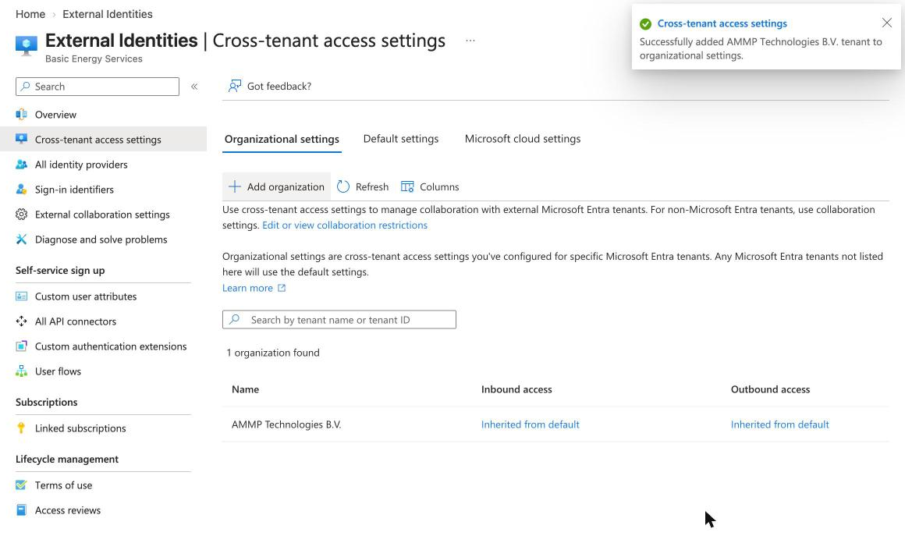

### Allow inbound B2B direct connect

**Step 3.** Select **Inherited from default** under **Inbound access**. The page opens on the B2B collaboration tab; switch to the **B2B direct connect** tab.

**Step 4.** Select **Customize settings**. On the **External users and groups** sub-tab, select **Allow access**. "Applies to" is already set to all AMMP Technologies B.V. users and groups.

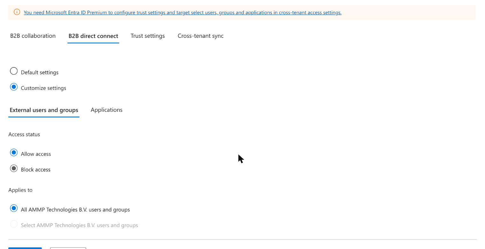

**Step 5.** Open the **Applications** sub-tab. It starts on **Block access**, so change it to **Allow access** (All applications), then select **Save**. One Save covers both sub-tabs.

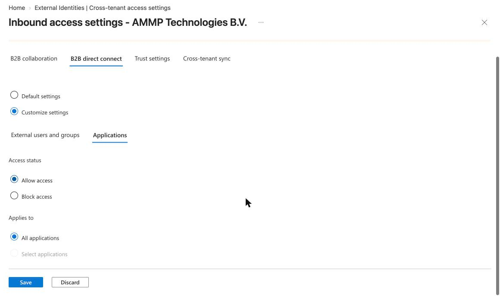

### Allow outbound B2B direct connect

**Step 6.** Close the inbound page. In the AMMP row, select **Inherited from default** under **Outbound access**, then switch to the **B2B direct connect** tab.

**Step 7.** Select **Customize settings**. On the **Users and groups** sub-tab, select **Allow access**. "Applies to" shows all users in your organisation.

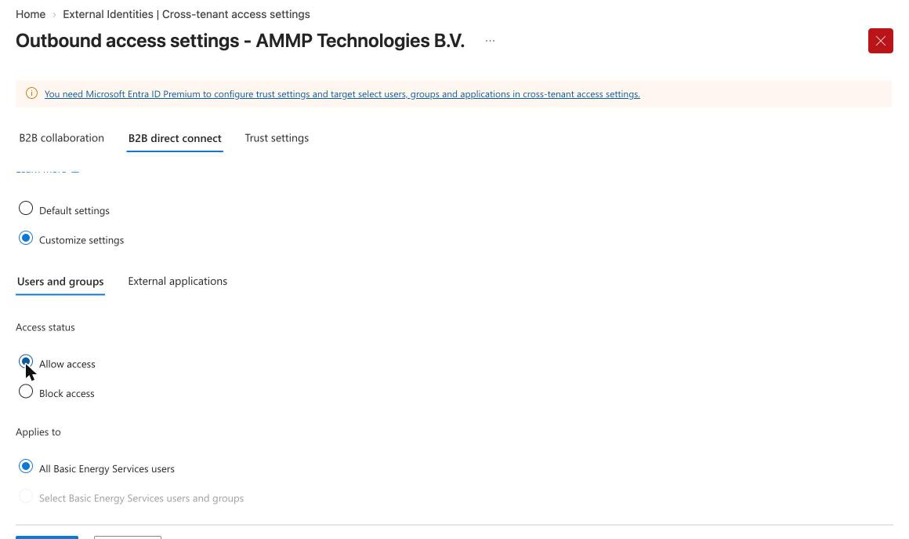

**Step 8.** Open the **External applications** sub-tab. It also starts on **Block access**: change it to **Allow access** (All external applications), then select **Save**.

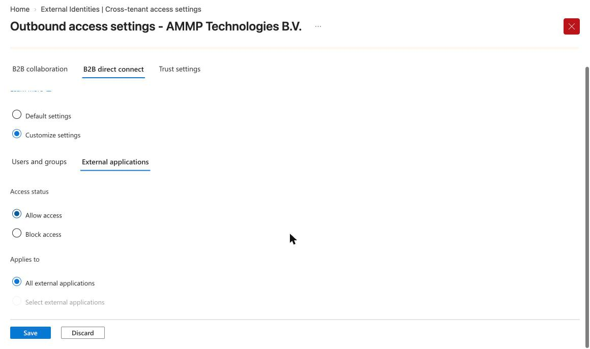

**Step 9.** A dialog asks you to confirm that organisations you enable outbound access for can see limited contact data about your users. This is what lets AMMP find and invite your users to the channel. Select **Yes**.

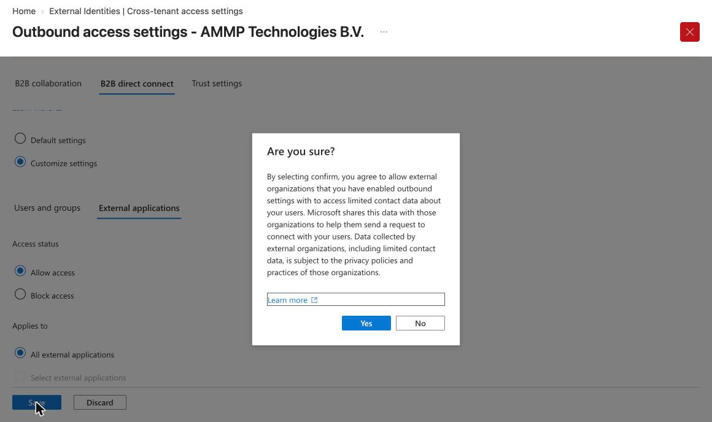

### Check the result

Back in Cross-tenant access settings, the AMMP row should show **Configured** under both Inbound access and Outbound access. Leave the B2B collaboration and Trust settings tabs unchanged; shared channels need only B2B direct connect.

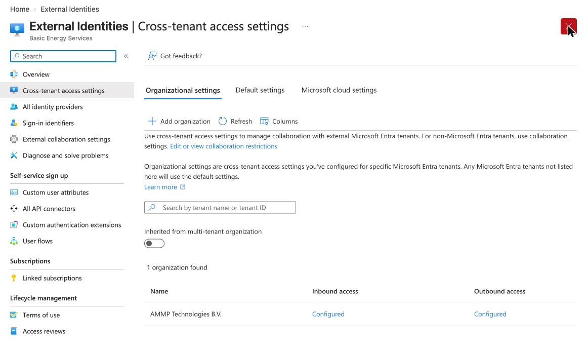

## After setup

Once you've made the change, let your AMMP contact know which option you used. AMMP has already allowed B2B direct connect on its side, so you don't need to do anything else.

1. AMMP creates the shared channel and invites the people you name.
2. They see the channel appear in Teams under your own organisation's list of teams, with an external icon.

Settings can take a few hours to take effect across Microsoft 365. If an invite fails right after the change, wait and try again later. If it still fails, email [support@ammp.io](mailto:support@ammp.io) with a screenshot of the AMMP row in Cross-tenant access settings (Option 2) or of the Teams external collaboration Overview page (Option 1).

## Sources

- [Teams admin center: unified external collaboration settings](https://o365reports.com/unified-external-collaboration-settings-in-teams-admin-center/)
- [Microsoft Learn: Configure cross-tenant access settings for B2B direct connect](https://learn.microsoft.com/en-au/entra/external-id/cross-tenant-access-settings-b2b-direct-connect)
- [Microsoft Learn: Collaborate with external participants in a shared channel](https://learn.microsoft.com/en-us/microsoft-365/solutions/collaborate-teams-direct-connect)